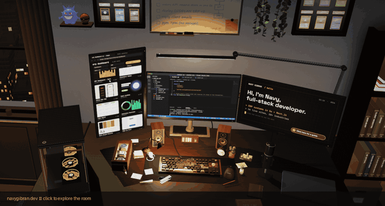

## About Me 

Hey! I'm **itsnevu**, a product builder. I take ideas from first sketch to launch, mostly around **AI agents**, **machine learning** and **automation**.

Right now I'm building **[Flowkite](https://flowkite.xyz)**, an AI browser agent for Chrome.

**Open for:** freelance projects, collaborations and full-time roles.

My portfolio is an interactive 3D desk. Click around the monitors, the whiteboard and the shelves at <a href="https://navygibran.dev/">navygibran.dev</a>.

## Featured Work

- **[Flowkite](https://flowkite.xyz)**: AI browser agent that plans and acts locally in your browser, and asks before it does anything that matters. [Get it on the Chrome Web Store](https://chromewebstore.google.com/detail/flowkite-ai-web-agent-aut/kacmblccfhnfcjfpeageldmmbkocafab). `TypeScript`
- **[Curb](https://github.com/itsnevu/Curb)**: Guardrails and circuit breakers for AI agents that stop runaway loops, cost blowups and destructive tool calls with one policy engine. `TypeScript` · `Python`
- **[Godplan ERP](https://godplan-erp.godjahstudio.com/)**: Multi-tenant business platform on a Go backend, with SSO and an operations dashboard. `Go`
- **[CoinSight](https://github.com/itsnevu/fe-coinsight)**: AI-powered on-chain research assistant with Solidity marketplace contracts, a FastAPI agent backend and a web client. `Solidity` · `Python` · `TypeScript`
- **[Credential Forgery Detection](https://github.com/itsnevu/credential-forgery-detection)**: ML + blockchain system that detects forged Indonesian diplomas and certificates, and anchors verified documents on-chain. `Python`
- **[Student Performance](https://student-performance-dj57-ptxezlcks-nepskuys-projects.vercel.app/)**: End-to-end ML pipeline predicting student graduation outcomes, with an interactive web demo. `Python`

<b>Client projects</b> (19 production sites, click to expand)

 

| ERP & Platforms | Manufacturing & Trade | Commerce & Services |
| :--- | :--- | :--- |
| [Godplan ERP](https://godplan-erp.godjahstudio.com/) | [Fortunarack.co.id](https://fortunarack.co.id) | [Godjahstudio.com](https://godjahstudio.com) |
| [Reconstruction.id](https://reconstruction.id) | [Dutamesh.com](https://dutamesh.com) | [Floraindonesia.com](https://floraindonesia.com) |
| [Yrm.co.id](https://yrm.co.id) | [Kusentangsel.com](https://kusentangsel.com) | [Nfopticalofficial.com](https://nfopticalofficial.com) |
| [Graciabox.id](https://graciabox.id) | [Miniaturkapal.com](https://miniaturkapal.com) | [Littleaivy.com](https://littleaivy.com) |
| [Izzi-bsd.com](https://izzi-bsd.com) | [Orthobone.store](https://orthobone.store) | [Ubbonlinepartners.id](https://ubbonlinepartners.id) |
|  | [Airon.site](https://airon.site) | [Nudelisius.com](https://nudelisius.com) |
|  |  | [Ratherabeautystudio.com](https://ratherabeautystudio.com) |
|  |  | [Damsgarage.id](https://damsgarage.id) |

## Tech Stack

## GitHub Stats

